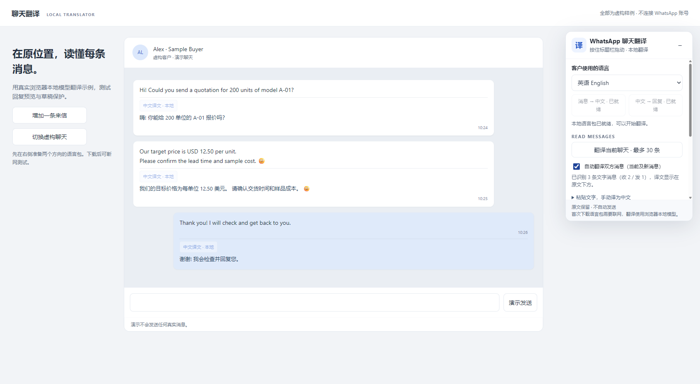

# WhatsApp Local Translator

在 WhatsApp 网页版的消息下方显示中文译文，使用浏览器本地翻译模型，无需 API Key。



由 [wanzihao491-rgb](https://github.com/wanzihao491-rgb) 主导，使用 AI 辅助开发。第三方独立扩展，与 WhatsApp、Meta、Ego 或 Google 没有官方隶属关系。

## 能做什么

- 收到和自己已发送的外语消息，都能在原文下方显示中文，保留原文。
- 单条翻译；批量处理当前最近最多30条已加载消息；开启自动后继续处理新消息。
- 用中文写回复，预览、编辑、复制，再主动填入空的 WhatsApp 输入框；发送由用户完成。
- 拖动标题栏移动面板，记住位置；高度最高约460像素，内容内部滚动；可折叠。
- 不接云翻译服务，不包含统计、广告或自动发送功能。详见 [隐私说明](PRIVACY.md)。

## 兼容范围

| 环境 | 当前状态 |
|---|---|
| 桌面 Ego | 0.1.2 已实测本地中英翻译、真实双方消息译文及拖动 |
| 桌面 Chrome / 其他 Chromium 浏览器 | 尚未实测；必须支持 Translator API 并能准备所需语言包 |
| WhatsApp 桌面客户端、手机 App | 本扩展不适用 |

浏览器本地模型不是本项目训练或分发的模型。Translator API 及语言包的可用性由浏览器决定。[接口说明](https://developer.chrome.com/docs/ai/translator-api)

## 安装

1. 下载本仓库源码 ZIP 并解压，或从本项目 Releases 下载版本安装包并解压。
2. 在 Ego 打开扩展管理页 `chrome://extensions/`，打开开发者模式。
3. 点击“加载未打包的扩展程序”，选择直接包含 `manifest.json` 的目录。
4. 打开或刷新 [WhatsApp Web](https://web.whatsapp.com/)。保持安装目录存在，不要随意移动。

当前是开发者模式安装版，未上架扩展商店。开源仓库更新不会自动替换电脑上的已安装文件。

## 使用

1. 在面板选择客户使用的语言，点击两个方向的“准备”按钮。首次下载语言包需要联网。
2. 点消息下的“译为中文”，或开启“自动翻译双方消息（当前及新消息）”。
3. 写回复时，在面板输入中文 → 翻译回复 → 核对译文 → 填入 WhatsApp → 自己发送。已有草稿时拒绝覆盖，可改用复制。

消息译文按“所选客户语言 → 中文”处理，不是逐条自动识别语言。自己的中文需要译成客户语言时，使用“用中文写回复”区域。

按住标题栏可移动面板；键盘聚焦标题栏后用方向键移动，Shift+方向键加大步长。面板内容可上下滚动，右上角减号可收起。

切换聊天会关闭自动翻译并清理旧会话结果。关闭自动后不再开始当前自动批次的剩余条目，已经开始的单条可能完成。

## 更新

下载新版并替换原安装目录中的文件，在扩展管理页点击本扩展的“重新加载”，然后刷新 WhatsApp 页面。更新前先保留未发送草稿。

查看 [更新记录](CHANGELOG.md)。每个发行版本的 ZIP 对应独立版本号；商店自动更新尚未接入。

## 限制

- 每条最多4,000字符；不自动向上滚动获取历史。
- 不处理语音、图片OCR、视频、贴纸或附件内容。
- 语言包选项包括英语、西语、葡语、法语、德语、阿语、俄语、日语和韩语；目前实测中英双向，其他语言待验证。
- 机器翻译需人工核对价格、数量、型号和条款。WhatsApp 页面改版可能需要更新适配。
- 真实回复输入框的填入联动仍待进一步实测；虚构夹具中已验证草稿保护和无自动发送。完整结果见 [验证记录](VALIDATION.md)。

## 开发和演示

安装使用扩展无需 npm。开发测试建议 Node.js 24.15 或更新的24.x版本。

```sh
npm ci --ignore-scripts
npm test
node scripts/serve.mjs
```

打开 `http://127.0.0.1:4174/demo/index.html`，所有聊天均为虚构。演示与正式扩展复用运行代码，首次准备语言包仍需联网。Ctrl+C 停止演示服务。

`npm run package` 在 Windows/PowerShell 中生成 `dist/whatsapp-local-translator-0.1.2.zip`，只包含指定运行文件和说明。测试依赖不会进入安装包。

## 反馈与许可

欢迎提交 Issue 和改进。请使用虚构或脱敏样例，不要上传真实聊天、客户联系方式或凭据。参与方式见 [CONTRIBUTING.md](CONTRIBUTING.md)。

[MIT License](LICENSE)。开发依赖遵循各自许可证，版本和许可字段保留在 package-lock.json 中。
